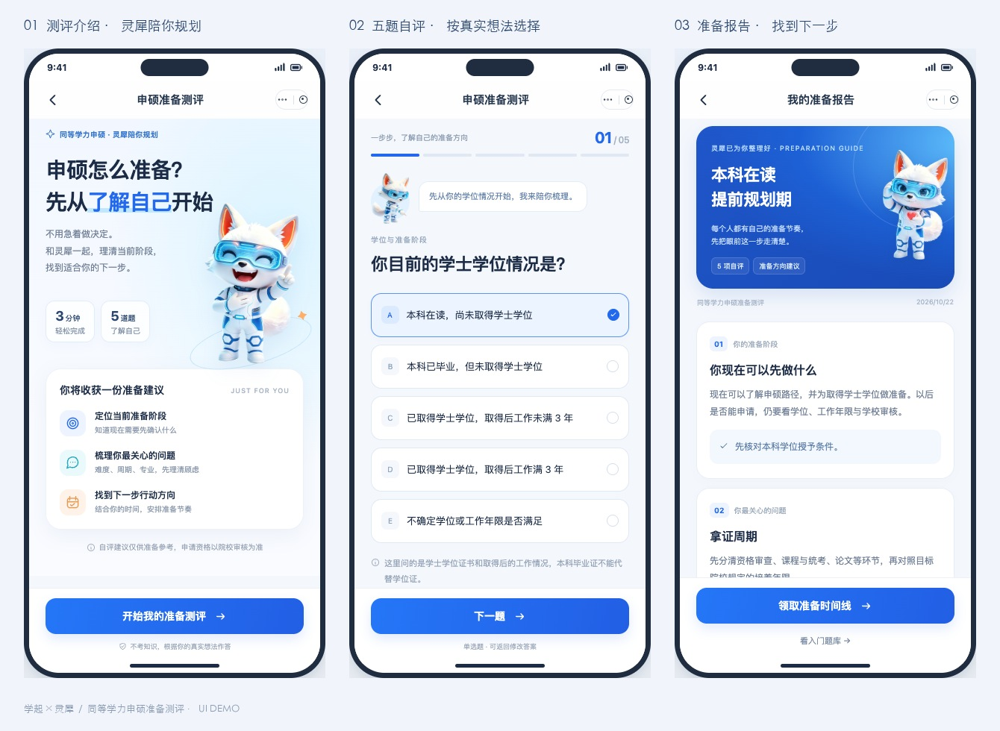

# 同等学力申硕准备测评 · 灵犀 UI Demo

灵犀形象与申硕准备测评相结合的可交互 UI 演示。

## 在线体验

https://ayo993.github.io/lingxi-shenshuo-ui-demo/

## 页面与交互

- 学起首页活动入口与双策略选择页
- 测评介绍、五道自评题、按答案生成的准备报告
- 四类典型报告场景与顾问微信承接弹层
- 手机屏幕适配、可滚动内容与底部固定操作

签到策略仅展示入口；二维码、题库及咨询承接为演示内容。
报告基于用户自评，不代替院校资格审查。

## 本地查看

下载 `index.html` 后直接用浏览器打开。灵犀图片、样式和交互均已内嵌，无需安装依赖。

## UI 预览

本仓库用于产品原型评审。灵犀形象与相关素材的权利归原权利人所有。
